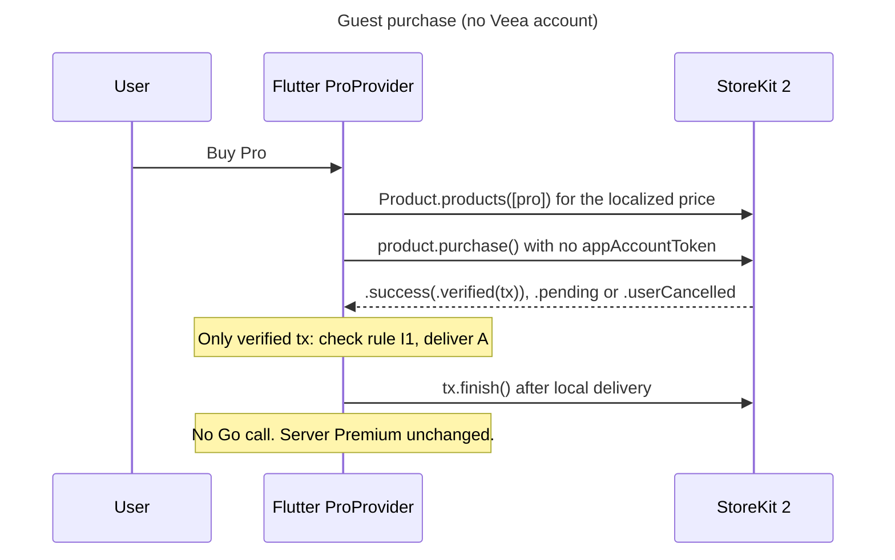
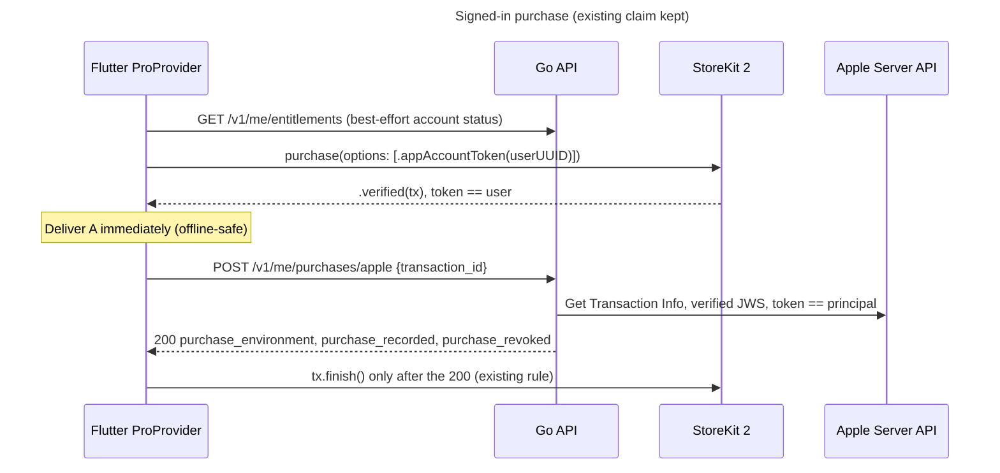
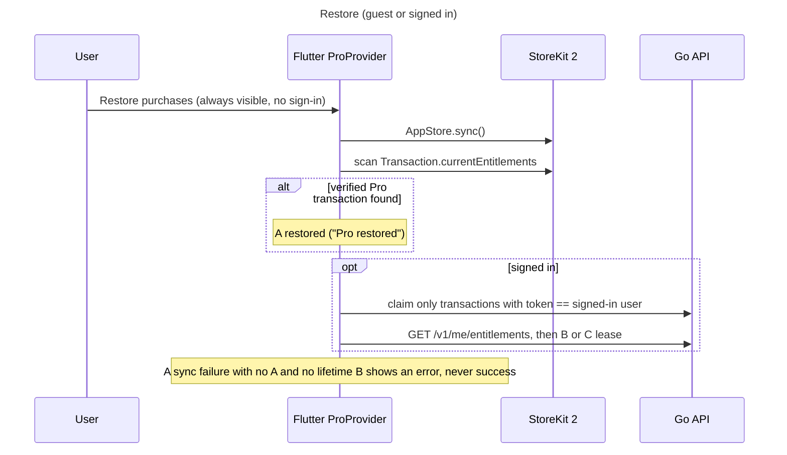

# TRD 11 — Apple App Store One-Time Pro Purchases

**Status:** v1.0 draft implemented in code (local verification only; App Store Connect product/key configuration and real-purchase verification remain deployment gates).
**Date:** 2026-11-17
**Depends on:** [TRD 04](04-account-lifecycle-data-rights.md), [TRD 09](09-free-premium-entitlements.md), [TRD 10](10-server-delivered-cartridges.md).

## 1. Scope and product rules

1. **Offline-first vocabulary unchanged:** Local notebooks, listening, and review remain unlimited on Free and Pro, and vocabulary remains offline without new word-sync requirements.
2. **Free app protection:** All Screen Time controls and unlock challenges are free. Pro enables configurable multi-word standalone Practice Rounds. See [§7](#7-storekit-first-ownership-amendment-a).
3. **One-time non-consumable purchase:** Pro is sold as one App Store **Non-Consumable**, with target Vietnam price 99,000 VND, no trial or recurring subscription. Display Apple's localized price; App Store configuration and guideline 4.10 review remain release gates.
4. **StoreKit-first and optional account binding:** Guests buy and restore without sign-in. Signed-in purchases use the Veea user UUID as the StoreKit account token and preserve Go claims under [§7](#7-storekit-first-ownership-amendment-a).
5. **Server configuration is opt-in:** Go purchase verification returns `503 purchase_unavailable` when unconfigured. Device checkout requires the release SKU and StoreKit product availability.

## 2. Apple App Store Server API verification (`backend/internal/appleiap`)

- **Package contract:**
  - `type Config struct { IssuerID, KeyID, PrivateKey, BundleID, Environment string; ProductIDs []string }`
  - `func New(Config) (*Verifier, error)`
  - `func (v *Verifier) Verify(ctx context.Context, transactionID string) (Transaction, error)`
  - `type Transaction struct { ID, OriginalID, ProductID, BundleID, Environment string; AccountToken uuid.UUID; PurchasedAt, SignedAt time.Time; RevokedAt *time.Time; RevocationReason *int32 }`
  - Sentinel errors: `ErrUnavailable` (unconfigured verifier, network/timeout failure, or Apple 401/403/429/5xx) and `ErrInvalid` (malformed or nonexistent transaction ID, invalid JWS/x5c chain, or mismatched claims).
- **Fresh server-to-server lookup:** Every `Verify` call mints a short-lived (5-minute) `ES256` JWT (`iss`, `iat`, `exp`, `aud: "appstoreconnect-v1"`, `bid`) and calls Apple's fixed `Get Transaction Info` endpoint (`https://api.storekit.apple.com/inApps/v1/transactions/{transactionId}` for `Production`, `https://api.storekit-sandbox.apple.com/inApps/v1/transactions/{transactionId}` for `Sandbox`). Arbitrary base URL overrides are not exposed in `Config`.
- **Pinned Apple PKI verification:** `signedTransactionInfo` is verified against the embedded **Apple Root CA - G3** certificate (`SHA-256: 63343abfb89a6a03ebb57e9b3f5fa7be7c4f5c756f3017b3a8c488c3653e9179`), never trusting an arbitrary root supplied in `x5c`. The leaf certificate must carry Apple's receipt-signing OID (`1.2.840.113635.100.6.11.1`) and the intermediate certificate must carry Apple's WWDR OID (`1.2.840.113635.100.6.2.1`).
- **Required claims:** `alg == "ES256"`, `transactionId` matches the requested ID, `bundleId` matches `Config.BundleID`, `productId` is in `Config.ProductIDs`, `environment` matches `Config.Environment`, `type == "Non-Consumable"`, `inAppOwnershipType == "PURCHASED"`, `!isUpgraded`, `appAccountToken` is a valid non-nil UUID, `purchaseDate` is not in the future, and `signedDate` is not before the purchase or in the future (allowing clock skew). Historical purchases are accepted: as in Apple’s official verifier with online certificate checks disabled, certificate validity is checked at the signed date. Freshness comes from the authenticated server-to-server lookup; client JWS is never accepted. If `revocationDate` is present, `RevokedAt` and `RevocationReason` are returned on `Transaction` for caller reconciliation.

## 3. Entitlements, reconciliation, environment isolation, and lifecycle rules

1. **HTTP contract (`POST /v1/me/purchases/apple`):**
   - Bearer-authenticated via `authenticated`; accepts strict JSON `{"transaction_id": "<id>"}`.
   - Verifies that `Transaction.AccountToken == principal.UserID`; refuses cross-account claims (`409 purchase_ownership_conflict`).
   - Returns `200 OK` with the `GET /v1/me/entitlements` response shape plus `purchase_revoked` (`plan`, `plan_expires_at`, `limits`, `checked_at`). An active lifetime purchase yields `plan: "premium"` with `plan_expires_at: null`.
2. **Revocation commit & 200 reconciliation:**
   - When Apple reports `RevokedAt != nil` on a transaction owned by the caller, `POST /v1/me/purchases/apple` **commits** the revocation state in PostgreSQL and returns `200 OK` with the updated effective `Entitlements` (which resolves to `"free"`, or `"premium"` with `plan_expires_at` if an independent manual grant from TRD 09 is active) rather than `403`, allowing the client to clear its local server lease and finish the StoreKit transaction cleanly.
   - Because refunds can occur after initial verification, server-side entitlement reads enforce a fresh verification TTL / server reconciliation window (re-verifying every 5 minutes when online and bounding server lease reliance to 24 hours) so refunded purchases do not remain Premium indefinitely from stale database state.
3. **Independence from manual staff grants (TRD 09):**
   - Manual grants remain in `entitlement_grants` (`source = 'manual'`, bounded to 366 days, managed by `admin.ChangePlan`). Apple purchases are stored separately so they never collide with the 366-day check constraint or `entitlement_grants_one_open`, and provider revocation never revokes a manual grant.
4. **Environment isolation (`apple_iap_control` & composite keys):**
   - Durable purchase uniqueness namespaces transaction identifiers by `(environment, original_transaction_id)` and `(environment, transaction_id)` so Sandbox transaction IDs can never collide with or poison Production records.
   - A singleton `apple_iap_control` table pins the database's active Apple environment and refuses API startup if `VEEA_APPLE_IAP_ENVIRONMENT` mismatches the database environment.
5. **Account deletion, export, and privacy:**
   - The TRD 04 account purge deletes all owned Apple purchase rows for the erased account. Because Apple's signed `appAccountToken` remains bound to the original account's UUIDv7 inside Apple's transaction record, a deleted account's purchase cannot be restored onto a newly registered account (`appAccountToken != newUser.ID`), avoiding any need to retain pseudonymous payment rows after account erasure. Any cross-account transfer after account deletion requires an explicit operator support policy.
   - The TRD 04 owner export (`AccountExport`, schema 3) includes up to the 5 latest verified purchase proofs (`MaxExportedPurchases = 5`) so the worst-case export header remains strictly within `learning.MaxHeaderBytes` (16 KiB).

6. **Review/TestFlight acknowledgements on the release API (26 November 2026):** An explicit `VEEA_APPLE_IAP_ALLOW_SANDBOX=true` on a Production verifier/database enables Production-first lookup with Sandbox retry only on Apple HTTP 404/error 4040010. A fresh, signed, account-owned Sandbox proof is acknowledged after active-user/session revalidation; it never writes/prunes purchase rows or grants Production server Premium. The response retains the actual Production plan and adds `purchase_environment`/`purchase_recorded`; device Pro comes from StoreKit. Stored Production reconciliation requires a Production proof, even for colliding IDs. Dedicated Sandbox databases keep the existing durable test path. Device caches are scoped by verified environment, API origin, owner and SKU. See [deployment and device acceptance](../payment-environments.md).

## 4. Remaining deployment and release gates

- Configure App Store Connect non-consumable product ID(s), In-App Purchase key (`.p8`), Key ID, Issuer ID, and Bundle ID, and supply `VEEA_APPLE_IAP_*` environment variables in staging/production.
- Verify real Sandbox and TestFlight purchases, restores, cross-account mismatch refusal, and refund/revocation reconciliation on a signed iOS device. Nothing in local automated tests asserts legal/tax compliance or live App Store billing execution.

## 5. Offline notebook and UI decisions (2026-11-17)

- The user confirmed **one device notebook**, unchanged on sign-in/sign-out/account switch. Production `GoAuthProvider(accountNotebooks:false)` leaves the active local notebook and practice rules intact. Confirmed online account deletion removes the session/payment link and **keeps device words**. Existing alternate workspace archives are retained untouched; they are not silently merged into the active notebook.
- `AppConfig.isVocabularySyncEnabled=false` disables the production sync service, learning engine, cloud import prompts and server cartridge installs. Accounts and purchases use the Go API independently. Do not enable vocabulary sync by merely flipping the constant: ownership migration and explicit import consent need a separate design/review.
- Backups exported by the production vocabulary provider use `source.kind=device`, with no account ID. User-selected local restores remain available while signed in or signed out. They never upload words and are not marked as eligible guest-created sync data.
- A confirmed server lifetime plan blocks duplicate checkout. A failed account preflight leaves StoreKit checkout available. Temporary manual access stays independent.
- Restore requests made during sign-in are queued, pending StoreKit updates are coalesced, and successful claims are cached for five minutes per account/session. Explicit restore and pending refund/approval updates bypass this cache.
- StoreKit entitlement updates never mutate protection settings.
- A pending response preserves independent manual access and indicates that stored Apple proofs could not be verified.

## 6. References

- [Apple sandbox testing](https://developer.apple.com/help/app-store-connect/test-in-app-purchases/overview-of-testing-in-sandbox): no charges for sandbox/TestFlight purchases; Xcode simulation is separate.
- [Apple’s official signed data verifier](https://github.com/apple/app-store-server-library-python/blob/main/appstoreserverlibrary/signed_data_verifier.py): certificate time at signedDate with online checks disabled. Veea accepts signed data only from its fresh authenticated Apple HTTPS response.
- [Apple Root CA G3](https://www.apple.com/certificateauthority/AppleRootCA-G3.cer): downloaded public root fingerprint independently matched the embedded certificate.

- Billing readiness is explicit: `apple_purchase_available` is returned true only when the server verifier is configured. StoreKit handles local checkout independently.
- Claims and account leases require the signed-in Veea user. StoreKit local access follows the Apple Account.
- Detailed setup, no-charge TestFlight checklist, verification evidence and remaining release gates: [first paid release](../first-paid-release.md).

- Apple refund reversals are supported: durable proofs retain Apple's `signedDate`. Newer signed state can reinstate access after a reversed refund; older active/refunded responses cannot override a newer state. Refunded proofs are periodically rechecked as well. See [Apple REFUND_REVERSED](https://developer.apple.com/documentation/appstoreservernotifications/notificationtype).

## 7. StoreKit-first ownership (Amendment A)

**Owner decisions D1–D7, 27 November 2026.** This amendment replaces the former
product and client-ownership rules in §1 and §5. The Go verification, database
and isolation rules in §2–§3 continue to apply. See the [Free/Pro model](../pro-99k-model.md).

### 7.1 Product scope

All Screen Time functionality, the existing practice pool and configurable
unlock questions are free. Standalone Practice Rounds reuse the vocabulary
review engine. Free rounds contain one word, and Pro can configure a larger
round from available words. Rounds work without Screen Time or a Veea account.

### 7.2 Selected architecture: Option A (link deferred)

| Option | Summary | Verdict |
| --- | --- | --- |
| **A** | Apple purchases unlock local educational features through StoreKit on any device using the same Apple Account, with or without a Veea account. Signed-in purchases still carry `appAccountToken` and keep the existing server claim. Guest purchases are never linked to an account. | **Approved.** It meets every required user-experience item. It needs no backend, API or database change, and it keeps every existing server invariant. |
| B | Option A plus securely linking a guest purchase to a Veea account later. | **Deferred.** A transaction ID or a client claim isn't proof that the user controls the Apple Account that bought it. A safe link needs a mechanism Apple can verify, plus consent, conflict rules, a new link record, and purge and export participation (see §7.6). Nothing in the first release needs it, because no shipped feature depends on server Premium. |

### 7.3 Entitlement sources and resolution

| Source | Proof | Scope | Lifetime offline |
| --- | --- | --- | --- |
| **A. Local Apple entitlement** | A StoreKit 2 `.verified` transaction in `Transaction.currentEntitlements` (rules in §7.8 I1) | This device's Apple Account, signed in or out, any Veea account | As long as StoreKit keeps it on the device; StoreKit is the authority |
| **B. Server Apple account entitlement** | An `apple_pro_purchases` row verified freshly by the Go server, with `appAccountToken == user` (unchanged) | The signed-in Veea account | Existing 24 h device lease, namespaced by origin, environment, owner and SKU |
| **D. Sandbox device-only** | Verified StoreKit Sandbox transaction on an accepted installation | The Apple Account on a Sandbox device | StoreKit only on a release API; no Production server row |
| **C. Server manual grant** | `entitlement_grants`, written only by `admin.ChangePlan` (unchanged) | The signed-in Veea account | Existing lease: min(expiry, 24 h) |

Resolution rules:

1. **Device Pro** (local educational features) = A OR D OR (signed in AND an active lease for B or C). Server data never cancels a valid A. A never extends a lease.
2. **Server Premium** = B OR C, evaluated only by `entitlement_premium_until()`. **A never contributes to it.** A device-verified purchase never grants server Premium to whatever account is signed in.
3. **The UI names the source:**
   - A: "Veea Pro (Apple purchase)".
   - B without A: "Veea Pro linked to your Veea account".
   - C: "Premium access until <date>".
   - Restore success is reported only for A, or for B as a lifetime plan with no pending verification. It is never reported for C.
4. **Duplicate checkout is blocked** when A is present, or when the signed-in server plan is lifetime B. C never blocks checkout, so a manual-grant user can still buy lifetime.
5. **Sign-out** removes the B and C leases for that owner and leaves A untouched. Switching accounts swaps the lease namespace. A is the same for every account.

### 7.4 Purchase and restore sequences

Refund or revocation: StoreKit removes the transaction from `currentEntitlements` and sends `Transaction.updates`, so A ends. While offline, the device learns this only after it reconnects. That is a StoreKit limitation, documented and accepted. B is revoked through the existing claim or owner reconciliation. C is unaffected.

### 7.5 Finish and recovery policy

- **Token equals the signed-in owner:** unchanged. Finish only after the Go 200 that includes `purchase_revoked`, and keep the existing pending, retry and unfinished-recovery behavior.
- **No token, a different account's token, or signed out:** finish after local delivery of A (after checking rule I1). Claim retry never depends on unfinished transactions, because claim candidates come from scanning `currentEntitlements` whenever the user is signed in.
- **`.pending` (Ask to Buy):** no access. Approval arrives through `Transaction.updates` and the same rules apply.
- **Unknown payment result or `.unverified`:** no access and no finish, with the existing error copy.

### 7.6 Account deletion, re-creation and linking

1. **Deletion** keeps the existing TRD 04 purge of `apple_pro_purchases`. A on the device continues, because the Apple Account owns the purchase. The deletion dialog should say: "Your Apple purchase stays with your Apple Account and keeps working on devices signed in to it. Account-linked Pro on other Apple Accounts ends."
2. **Re-creating an account** never claims the old-token transaction (the server would return 409). The client doesn't attempt it: it claims only when `token == owner`. A keeps the user's Pro on the device.
3. **No automatic or manual relinking in the first release.** A guest purchase stays a device and Apple Account entitlement only.
4. **Future Option B prerequisites** (a separate design):
   - A mechanism Apple can verify that proves control of the purchasing Apple Account. Candidates such as setting or updating the app account token through the App Store Server API, or matching `appTransactionId`, must be confirmed against current Apple documentation first.
   - Explicit user consent.
   - One account per `(environment, original_transaction_id)`, with a conflict response and no silent transfer.
   - Audited operator support.
   - A new link record covered by purge and export.

### 7.7 API and data model

- **No Go code, API, migration or SQL change is required.** `POST /v1/me/purchases/apple` keeps `appAccountToken == principal`. Guest transactions are never sent, so `invalid_proof` alerts would catch a client regression that sends them.
- **OpenAPI (optional wording only):** state that Premium describes server entitlements and doesn't reflect device-only StoreKit purchases.
- **Kill switch:** `apple_purchase_available` describes server-claim availability. Stop new sales with **Remove from Sale** in App Store Connect. Valid prior purchases remain restorable.
- **Monitoring:** no new server metric. Keep `apple_purchase_verification_total` and its alerts. Expect fewer claims, because guests don't claim.
- **Privacy:** guest purchases send nothing to Veea. Signed-in claims keep linking purchase history to the account, so the App Privacy "Purchases" answer stays "linked to identity" for account users.

### 7.8 Security invariants

- **I1. Local acceptance.** A requires all of:
  - StoreKit `.verified`
  - `productID == com.nintran.veeaEnglishApp.pro`
  - `productType == .nonConsumable`
  - `ownershipType == .purchased` (new local check)
  - `revocationDate == nil` and `!isUpgraded`
  - environment allowed by `ProPurchasePolicy` (Production, or Sandbox in TestFlight or review; never Xcode in release)
  - not in the local revocation deny list
- **I2.** A unlocks only local educational features. It never writes, extends or implies server Premium.
- **I3.** Server ownership (B) requires a fresh Apple Server API lookup with pinned PKI and `appAccountToken == principal`. A transaction ID, a client JWS or a client flag alone is never ownership proof.
- **I4.** There is no automatic transfer between accounts, and a server row's `user_id` never changes (existing database `CHECK user_id = app_account_token`).
- **I5.** Idempotency, freshness, the reconciliation gate, refund-reversal ordering and Production/Sandbox namespaces are unchanged.
- **I6.** Manual grants (C) are independent and never report a restore as successful.
- **I7.** The revocation deny list moves to a namespace independent of the owner: `pro.revoked.v3.<environment>.<productID>`, holding transaction IDs only. Existing `v2` keys keep working for B.
- **I8.** Screen Time authorization, shields, DeviceActivity monitoring, schedules and app counts never depend on any entitlement source.

### 7.9 Edge-case and acceptance matrix

| # | Scenario | Expected |
| --- | --- | --- |
| 1 | Guest buys | A active; no Go call; transaction finished; extra Pro learning features available |
| 2 | Guest cancels, gets pending, or gets an unverified result | No access, no finish, accurate message |
| 3 | Guest restores on a reinstall or a second device with the same Apple Account | `AppStore.sync`, then A; "Pro restored" |
| 4 | Restore with nothing owned | "No Pro purchase found"; never success from C |
| 5 | Signed-in purchase | A immediately; claim then finish; server B lifetime |
| 6 | Sign out after purchase | A remains; B and C leases cleared |
| 7 | Guest purchase, then sign in | A remains; no claim attempted; plan reflects only B or C; no linking prompt |
| 8 | Old-token purchase, account deleted, new account | A remains; no claim attempted; no 409 surfaced; checkout blocked by A |
| 9 | Account switch on the same Apple Account | A unchanged; leases switch; B belongs to the token's account only |
| 10 | Manual grant only | Device Pro until min(expiry, 24 h lease); restore says no Apple purchase; checkout still allowed |
| 11 | Refund while online | `Transaction.updates`, then A removed; B revoked on claim or reconciliation; C unaffected |
| 12 | Refund while offline | A stays until StoreKit refreshes after reconnecting (documented limitation) |
| 13 | Refund reversal | StoreKit shows the entitlement again, so A returns; B follows the newer signed state |
| 14 | Apple or Go outage | A unaffected; signed-in claim stays unfinished and retries; GET 503 doesn't remove A |
| 15 | Xcode StoreKit transaction in a release build | Rejected |
| 16 | TestFlight Sandbox purchase on the Production API | A on the device; server acknowledgement only (unchanged) |
| 17 | Family-shared ownership (not configured) | Rejected locally and by the server |
| 18 | Screen Time on Free | Multiple apps (up to 50), all durations, enable, disable and remove, with no Pro check anywhere |
| 19 | Previous Free downgrade left paused locks | Apps stay paused and user-enableable; nothing re-enabled silently |
| 20 | Pro learning feature on Free | Paywall without sign-in; free notebook features never blocked |

### 7.10 Migration and rollback

- **Database:** none. Migration 16 and `apple_iap_control` are untouched.
- **Client state:**
  - Old `v2` owner-namespaced leases and deny lists still apply to B.
  - A adds `v3` deny-list keys.
  - Paused extra locks stay paused (user choice is kept).
  - The saved word-count preference is kept.
- **Point of no return:** once guest purchases exist in production, going back to account-only ownership would strand those buyers. Treat Amendment A as a **one-way business commitment**.
- **No re-gating:** once Screen Time features are free, never put them behind payment again. That would also reintroduce the 4.10 risk.
- **Server rollback** is unchanged: every client version works with the current API.

### 7.11 Release acceptance

Run §7.9 on a signed device. The optional Veea account and Apple Account are
separate. After Veea deletion use Restore Purchases with the original Apple
Account. Operators cannot relink an old-token purchase. Direct purchase issues
to the published Veea support channel and refund requests to
[Apple’s refund flow](https://reportaproblem.apple.com/). Disclosure and any
unverified deployment provider retention are covered by the
[App Store Connect privacy checklist](../app-store-submission.md#app-privacy-checklist).
